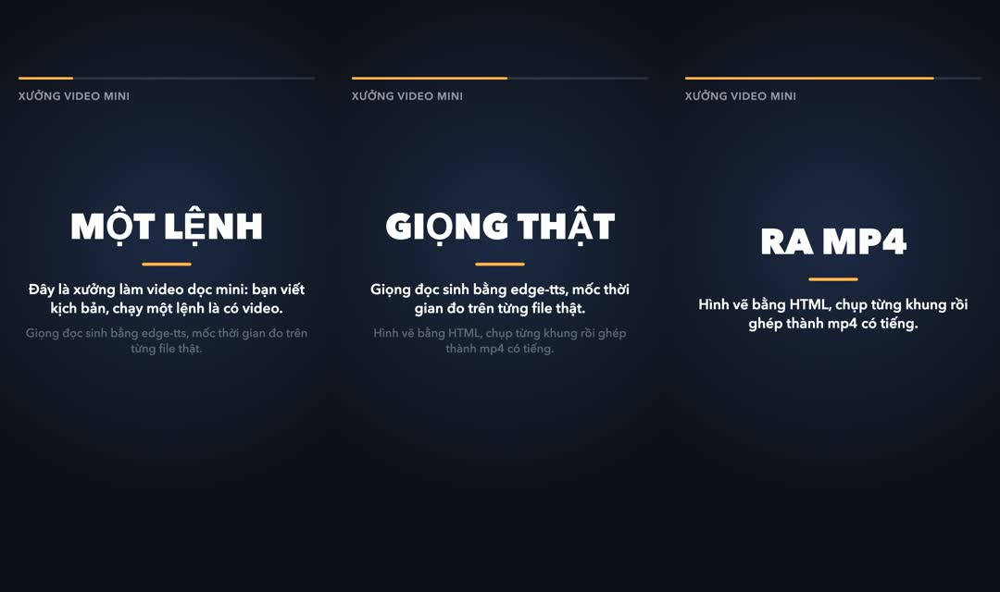

# mini-video-workspace · Xưởng video mini

Viết kịch bản, chạy một lệnh, ra video dọc 9:16 (1080×1920, 30 fps) có giọng đọc tiếng Việt và chữ chuyển động khớp lời.
Không mở phần mềm dựng nào.

Repo gồm ba thứ:

| | Là gì | Dùng khi |
|---|---|---|
| `PROMPT.md` | Prompt dán vào agent viết code để nó **tự dựng lại** cả xưởng này từ một thư mục trống | Muốn xem agent làm thế nào, hoặc muốn có bản của riêng mình |
| Chính repo này | Xưởng đã dựng sẵn: `make.py`, khung hình HTML, luật cho AI, video mẫu | Muốn làm video ngay |
| Skill `tao-video` | Dạy agent đi từ ý tưởng tới mp4 đã kiểm trong xưởng này | Muốn chỉ nói "làm video về…" rồi để agent lo |

Repo đi kèm loạt video **Xưởng video AI** của Fx Studio.

## Demo

Video mẫu dựng từ [`projects/demo/script.json`](projects/demo/script.json) bằng đúng một lệnh
`.venv/bin/python make.py projects/demo`: 3 cảnh, 16,3 giây, 1080×1920, 30 fps, có giọng đọc.

<p align="center">
  <a href="projects/demo/out/video.mp4">
    
  </a>
  <br>
  <a href="projects/demo/out/video.mp4"><b>▶ Xem video demo (mp4, có tiếng)</b></a>
</p>

Kịch bản của video này chỉ có ba dòng:

```json
{ "id": "s1", "say": "Đây là xưởng làm video dọc mini: bạn viết kịch bản, chạy một lệnh là có video.", "show": "MỘT LỆNH" },
{ "id": "s2", "say": "Giọng đọc sinh bằng edge-tts, mốc thời gian đo trên từng file thật.", "show": "GIỌNG THẬT" },
{ "id": "s3", "say": "Hình vẽ bằng HTML, chụp từng khung rồi ghép thành mp4 có tiếng.", "show": "RA MP4" }
```

`show` là chữ to giữa màn hình, `say` là lời đọc kiêm phụ đề. Thanh cam trên cùng chạy theo thời lượng giọng thật.
Chạy lại `make.py` sẽ ghi đè `projects/demo/out/`, nên video bạn tự dựng có thể khác vài mili giây do giọng đọc.

## Xưởng chạy thế nào

```
script.json ──1. VOICE──▶ voice/ + timing-manifest.json ──2. HTML──▶ trang có window.seek(t)
                                                                          │
              out/video.mp4 ◀──4. MUX── out/silent.mp4 ◀──3. RENDER───────┘
```

1. **VOICE:** mỗi câu một file giọng bằng edge-tts, đo độ dài thật, ghi `timing-manifest.json` (câu nào bắt đầu và kết thúc
   lúc nào, tính bằng mili giây). Hình biết khi nào đổi cảnh là nhờ file này.
2. **HTML:** nhét manifest vào khung hình `template/index.html`.
3. **RENDER:** Playwright mở trang, gọi `seek(t)` cho từng khung (30 khung một giây), chụp lại, đẩy thẳng vào ffmpeg.
   `seek(t)` vẽ khung hình tại giây t, cùng t luôn ra cùng một hình, nên chụp chậm hay nhanh cũng không lệch.
4. **MUX:** ffmpeg ghép hình với tiếng.

## Cài đặt (một lần)

Cần Python 3.10+, `ffmpeg` + `ffprobe` trên PATH (macOS: `brew install ffmpeg`), và mạng cho edge-tts.

```bash
python3 -m venv .venv
.venv/bin/pip install -r requirements.txt
.venv/bin/python -m playwright install chromium     # lần đầu tải vài trăm MB
```

Windows: thay `.venv/bin/` bằng `.venv\Scripts\`.

## Cách 1: làm video bằng tay

```bash
.venv/bin/python make.py projects/demo
```

Ra `projects/demo/out/video.mp4`. Video mới: chép `projects/demo/` thành `projects/<tên>/`, sửa `script.json`:

```json
{
  "title": "NHÃN NHỎ TRÊN ĐẦU",
  "segments": [
    { "id": "s1", "say": "Câu giọng đọc sẽ nói.", "show": "CHỮ TO" },
    { "id": "s2", "say": "Câu tiếp theo.", "show": "CHỮ KẾ" }
  ]
}
```

Mỗi segment là một cảnh. `show` nên 1–3 từ. Giọng đọc khoảng 2,5–3,3 từ/giây.

## Cách 2: nhờ agent, dùng skill `tao-video`

Mở repo trong Claude Code (đọc `.claude/skills/`) hoặc Antigravity / Codex (đọc `.agents/skills/`), rồi nói:

> làm video về 3 mẹo đặt tên file cho gọn

Agent viết kịch bản, trình bạn xem (bảo "cứ làm luôn" thì nó bỏ bước này), chạy `make.py`, kiểm mp4 bằng ffprobe, xem lại vài khung hình rồi báo đường dẫn.
Luật nó phải theo nằm ở `CLAUDE.md` (bản cho agent khác: `AGENTS.md`).

## Cách 3: tự dựng lại cả xưởng từ prompt

Mở một thư mục trống trong agent, dán khối prompt trong `PROMPT.md`. Prompt này đã chạy thật hai lượt từ thư mục trống, cả hai
ra mp4 đạt kiểm; chỗ agent vấp ở lượt trước đã viết lại vào prompt.

## Sửa giao diện

Sửa `template/index.html`. Mọi chuyển động phải tính từ t trong `window.seek(t)`: không CSS animation, không timer, không
`Math.random`. Sửa xong:

```bash
.venv/bin/python make.py projects/demo --check-seek
```

Phải ra `CHECK-SEEK: OK` (seek từng mốc theo ba thứ tự, ảnh phải giống hệt từng byte).

## Giới hạn

- edge-tts là thư viện mã nguồn mở (LGPLv3), gọi dịch vụ đọc của Microsoft Edge: miễn phí nhưng **không chính thức**, cần mạng,
  có lúc lỗi tạm thời (`make.py` tự thử lại tối đa 5 lần, báo câu nào lỗi). Muốn dùng cho việc thương mại thì tự xem điều khoản của Microsoft.
- Font lấy từ máy. Đã thử trên macOS; Linux/Windows có thể thiếu dấu tiếng Việt, khi đó cài font Noto Sans.
- Render bằng chụp màn hình nên chậm: khoảng 15–80 giây cho video 15 giây, tuỳ máy.
- Repo không đăng video lên đâu cả. Cổng cuối là người.

## Giấy phép

Phi thương mại, cho cá nhân, học tập, nghiên cứu: xem `LICENSE`.
